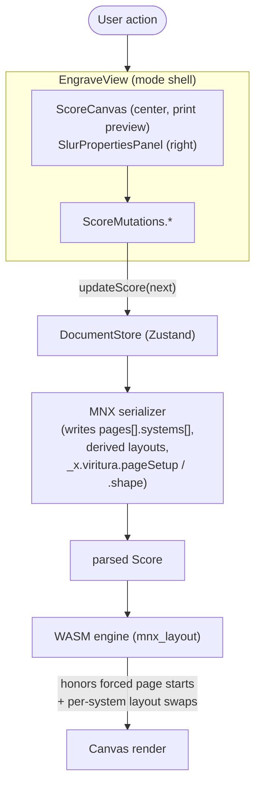

# Engrave Mode v1

Engrave Mode lets users author publication-quality decisions on top of the
music data captured in Write Mode. It is a distinct top-level mode (Activity
Bar) that operates on **per-`ScoreDefinition` view state** without ever
touching `parts[]`.

## Scope (v1 — shipped)

| Capability                                                     | UI                                                                                  | MNX persistence                                            |
| -------------------------------------------------------------- | ----------------------------------------------------------------------------------- | ---------------------------------------------------------- |
| Forced **system break** at a measure                           | Ctrl/Cmd+click on a barline; selected marker deletes with `Delete`/`Backspace`      | `pages[].systems[].measure`                                |
| Forced **page break** at a measure                             | Shift+click on a barline; selected marker deletes with `Delete`/`Backspace`         | new entry in `pages[]`                                     |
| **Hide / show staff** for a system                             | Ghost-rail eye icons in the canvas gutter → popover with per-staff toggles          | derived `LayoutDefinition` referenced from `system.layout` |
| **Per-score page setup** (size, margins, rastral)              | Select a score in the header, then edit it directly in Engrave left panel → Layouts | `_x.viritura.pageSetup` on the `ScoreDefinition`           |
| **Slur shape overrides** (per-handle bezier offsets in spatia) | Click slur → right panel shows `[p0, p1, p2, p3]` deltas + Reset; drag handles      | `event.slurs[]._x.viritura.shape`                          |
| **Reset breaks**                                               | Toolbar "Reset to auto layout"                                                      | clears `pages[]`                                           |
| **Restore hidden staves**                                      | Toolbar "Show all hidden staves" (conditional)                                      | strips derived `system.layout` overrides                   |

## Architecture



`ScoreMutations` ([`apps/editor/src/score/ScoreMutations.ts`](../../apps/editor/src/score/ScoreMutations.ts)) re-exports the per-feature modules so call-sites import from one place. Logic is split by feature:

| Feature           | Module                                                                                   | Key entry points                                                                                              |
| ----------------- | ---------------------------------------------------------------------------------------- | ------------------------------------------------------------------------------------------------------------- |
| Pagination breaks | `ScoreMutations.ts`                                                                      | `insertBreakInScore`, `clearBreakInScore`, `clearAllBreaksInScore`                                            |
| Staff visibility  | [`staffVisibilityMutations.ts`](../../apps/editor/src/score/staffVisibilityMutations.ts) | `setStaffVisibilityInScore`                                                                                   |
| Slur shape        | [`slurShapeMutations.ts`](../../apps/editor/src/score/slurShapeMutations.ts)             | `setSlurShapeInScore` (additive), `replaceSlurShapeInScore`, `getSlurShapeFromScore`, `clearSlurShapeInScore` |

### Pagination snapshot

`pages[].systems[]` is **all-or-nothing per score view**. The first time a
user authors _any_ break, the serializer enumerates every system boundary so
the engine sees a complete forced pagination. Helpers in
[`packages/core/src/model/pagination.ts`](../../packages/core/src/model/pagination.ts)
round-trip between that MNX shape and a flat `PaginationSnapshot` for UI
manipulation:

```ts
interface PaginationEntry { measure: string; layout?: string; pageBreak: boolean }
interface PaginationSnapshot { entries: PaginationEntry[] }

emptySnapshot(): PaginationSnapshot
extractSnapshot(score: ScoreDefinition): PaginationSnapshot
snapshotToPages(snap): PageDefinition[] | undefined
insertBreak(snap, measureId, "system" | "page", layout?): PaginationSnapshot
clearBreak(snap, measureId): PaginationSnapshot
sortSnapshot(snap, order: string[]): PaginationSnapshot
applySnapshot(score, snap): ScoreDefinition
```

### Derived layouts (hide-staff)

Hiding a staff on a system swaps that system's `layout` reference to a
generated `LayoutDefinition`. Each derived layout is minted with a fresh
UUID v7 id (no human-meaningful naming scheme) and flagged with
`_x.viritura.derived: true` so the GC can distinguish it from
user-authored layouts ([`packages/core/src/model/derivedLayouts.ts`](../../packages/core/src/model/derivedLayouts.ts)).

Dedup is **structural**, not id-based. A `canonicalLayoutKey` walks the
layout's content tree (sorted keys, `undefined` elided, instance `id`
and the `derived` bookkeeping flag excluded) and produces a stable
string. Any existing layout whose canonical key matches a candidate is
reused — whether it was user-authored or previously derived from a
different base. Two systems hiding the same parts collapse to one
layout; so do two layouts that converge on the same shape from
different bases (the case ossia / divisi / auto-hide will exercise).

| Helper                      | Behavior                                                                                                                                                                                             |
| --------------------------- | ---------------------------------------------------------------------------------------------------------------------------------------------------------------------------------------------------- |
| `deriveHiddenLayout`        | Prunes the requested parts out of a base layout's content tree; reports which ids were actually present.                                                                                             |
| `ensureDerivedLayout`       | Reuses an existing structurally-equal layout if one is present; otherwise mints a UUID v7, flags it `_x.viritura.derived: true`, and appends.                                                        |
| `pruneUnusedDerivedLayouts` | GCs unreferenced layouts whose `_x.viritura.derived` is `true`. User-authored layouts are never GC'd — MNX treats `layouts[]` as a library and authors may keep spare layouts around for future use. |

Two systems hiding the same set of parts deduplicate to one derived layout.
Showing all parts again removes the system override and triggers GC.

### Engine contract

`compute_page_breaks_with_forced(system_heights, config, title_height_px, forced_page_starts)` in
[`engine/viritura-engine/src/layout/page.rs`](../../engine/viritura-engine/src/layout/page.rs)
honors the explicit pagination boundaries while still falling back to auto-flow
for unforced gaps. Per-system layout swaps go through the `system_layout_changes`
map in [`engine/viritura-engine/src/layout/mnx_layout/explicit.rs`](../../engine/viritura-engine/src/layout/mnx_layout/explicit.rs);
a system's effective `layout` may carry a different (smaller) staff count than
the score's base layout.

Authored and varying-staff paged layouts measure each system before pagination,
using the same content-aware staff placement as rendering. Page fitting reserves
notation above the first staff and below the last staff, and budgets brace-group
gaps consistently with their rendered positions. Vertical justification uses
the measured content floors; compression preserves notation clearance and the
configured legibility floor rather than forcing notes to overlap. Staff size and
authored system/page starts remain unchanged.

Automatic page-turn planning initially estimates system heights. If measured
engraving overflows those page assignments, pagination is re-optimized using
the actual system heights and skyline gaps, keeping the selected systems and
cover-page choice. An overflow break must not leave the old estimated break
immediately afterward and strand a line on its own page. Fitting plans and
authored page breaks retain their selected boundaries.

Copyright is centered at the foot of the cover page when one is present;
otherwise it appears only in the first music page's footer. Pagination and
vertical justification reserve the copyright text height plus a one-spatium
clearance above it, raising the first page's music-frame bottom as needed.
Later pages and unpaged Horizon layout do not reserve this footer band.

Horizontal justification reserves system-start clef and key restatements as fixed
overhead before distributing bar widths. The first bar retains its rhythmic
spacing instead of paying for that extra furniture out of its note area.
Bar-width budgets use the shared rhythmic columns of all displayed parts, not
just the widest individual part, so cross-staff accidental and onset clearance
does not consume the elastic spacing of a busy bar.

Automatic hairpins and their endpoint dynamics move outward together to clear
tuplet numbers and brackets on the same side of the staff. Manual offsets and
collision-avoidance opt-outs retain their authored positions.

Repeat-ending brackets clear multimeasure-rest count numbers by at least 1sp.
A closed repeat ending stops 0.5sp before an adjoining ending, leaving their
hooks and horizontal strokes visibly separated. System continuations remain
open and continuous.

Tempo text is separated from a following parenthesized metronome mark by an
automatic space. Unformatted text and the opening parenthesis share a text run
so font shaping preserves that space; authored rich-text formatting is retained.
The metronome note clears the preceding parenthesis ink by at least 0.2sp,
using the bundled face's actual bounds, including bold and italic variants.

Automatic primary beams may join adjacent tuplets and ordinary notes within a
beat; secondary beams still separate at tuplet boundaries. Beat boundaries and
explicit beam choices remain authoritative.
Tuplet placement controls the bracket and number independently of the notes'
stem directions; selecting a tuplet and pressing `F` flips its placement.

Glissando labels follow the angle of straight or wavy lines, including descending
connections. Their lettering stays upright and its descenders clear the line's
ink by 0.4sp measured perpendicular to the line. Canvas, SVG and PDF preserve the
same rotation and placement.

Rehearsal marks default to bold `Arial, sans-serif` at 2.8sp, configurable in
House Styles > Text Styles > Rehearsal marks. The sans-serif stack is not bundled;
the browser chooses its sans-serif fallback when Arial is unavailable.
Boxed and circled marks center the measured label bounds and
reserve padding around descenders and side overhangs rather than assuming a
cap-height rectangle. Rich-text font, weight, slant, size and color overrides
take precedence over the house style. Rehearsal labels stay centered in their
frames rather than exposing the paragraph-alignment controls used by other roles.
System-font appearance can vary by platform; SVG/PDF font resolution is a
separate export concern and is not guaranteed to match installed Arial.

Automatic tempo placement keeps the marking's left edge inside its source bar
and limits horizontal displacement from its beat anchor to two thirds of that
bar's width, including subsequent collision dodges. Automatic part casting
breaks before a tempo-bearing bar when the remaining line cannot accommodate
the marking, then recasts the following music rather than stranding the bar on
an extra line. Page-turn pagination is updated for the resulting systems.
Authored system starts and manual offsets remain authoritative. If locked
systems or text wider than the frame make a fit impossible, the marking
overhangs to the right instead of moving into an earlier bar.

Slurs broken across systems project their known opposite endpoint onto the
current staff and retain the phrase's contour. Continuation tips clear the
boundary notes instead of imposing a fixed vertical-rise cap, and broken
segments use the shared exact-shape obstacle collector to clear accidentals.

Barline styles use the actual preceding measure's resolved boundary, including
after a collapsed multimeasure rest or across a stitched-horizon chunk seam.
Staff strokes and their inter-staff connectors use the same boundary style.
A collapsed rest at a system end uses the last covered measure's boundary
style and selection ID; changing that style invalidates retained rendering.

## Canvas interaction model

Engrave-mode interactions ride on `ScoreCanvas` event hooks rather than the
global `KeyboardRegistry`:

- `onEngraveBarlineClick(hit, mods)` — modifier disambiguates system vs page break.
- `onEngraveMarkerClick` + `useMarkerSelection` wire `Delete`/`Backspace` to clear the selected marker.
- `onEngraveStaffEyeClick(partId, systemMeasureId)` — fires from the ghost-rail eye glyphs and opens a per-staff toggle popover.
- `onEngraveSlurSelectionChange` + `onEngraveSlurShapeEdit(slurId, delta)` — selection drives the right-side `SlurPropertiesPanel`; handle drags are additive (`setSlurShapeInScore`), numeric panel edits replace (`replaceSlurShapeInScore`).

No global engrave-mode keybindings are registered today.

## Out of scope for v1 (deferred)

- **Canvas break-glyph overlays** in the gutter and ghost rows for hidden staves. Requires a dedicated ScoreCanvas overlay layer.
- **Engrave keyboard shortcuts** (`Ctrl+Enter` for system break, etc.). Requires its own `KeyboardRegistry` binding set.
- **Note spacing nudges, beam slope overrides, custom text frames, cross-staff stem tweaks** — broader engrave controls land in v2.
- **Bulk "copy breaks to other scores"** across part-extracted views.
- **Mid-system layout change with staff-count reduction** — the engine swaps staves 1:1; reducing staff count mid-system needs a system break instead.

## Validation

- Rust: `cargo test -p viritura-engine --lib test_per_system_layout_reduces_staff_count` ([`test_layouts.rs`](../../engine/viritura-engine/src/layout/tests/test_layouts.rs))
- TS:
  - `pnpm --filter @viritura/core test` — `pagination.test.ts`, `derivedLayouts.test.ts`
  - `pnpm --filter @viritura/editor test EngraveMutations EngraveRoundTrip`
- Storybook (`pnpm dev:storybook`, port 6007):
  - **App › Engrave Mode › Forced Breaks** (`SystemBreaksEveryTwoMeasures`, `PageBreakAtMidpoint`)
  - **App › Engrave Mode › Staff Visibility** (`HideOneStaffOnSystem`, `ProgressiveReveal`)
