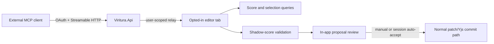

# MCP Integration

> **Status:** External MCP clients are the supported model-assisted interaction surface. The browser-hosted relay, OAuth flow, session routing, score queries, and in-app proposal review with optional session auto-accept are shipped. The experimental first-party chat panel and provider integration have been retired.

## Shipped architecture

Viritura exposes Streamable HTTP MCP at `https://api.viritura.com/mcp`. The authoritative score remains in an opted-in editor tab:



- Each editor tab must explicitly opt in before it registers a browser-host session.
- External clients use Authorization Code with S256 PKCE. One-hour reference access tokens are audience-bound and scoped to `score:read`, `selection:read`, and `score:propose`. Clients requesting `offline_access` receive reference refresh tokens that rotate on use, have no sliding expiry, and expire 30 days after authorization. Reusing a rotated refresh token is rejected; clients must start a new browser authorization after expiry or revocation.
- `editor.list_sessions` returns only the signed-in user's connected sessions. A `sessionId` is required when more than one session is available.
- The API relays calls to the authoritative tab and does not store score content.
- Capacity is bounded per user, per session, and globally. Relay registrations are in-memory, ephemeral, and tab-scoped; their IDs are not database records.
- An unattached registration expires after two minutes. A connected tab renews its one-hour lease with heartbeats; a disconnected tab has ten minutes to reconnect with the same registration. An authenticated reconnect can replace a stalled socket, and interrupted calls fail explicitly rather than waiting for the old socket. The server sweeps expired registrations every two minutes.
- A relay disconnect is not itself an OAuth failure. A legacy session-specific endpoint with a valid token returns `session_not_found` rather than an OAuth challenge when its registration expires. If the registration has expired or the server restarts, the editor creates a new registration; clients using a session-specific MCP URL may need to authorize that new resource. OAuth tokens and authorizations have their own storage and lifetime.
- Every 30 minutes the API prunes expired or invalid OAuth tokens created over 14 days ago and orphaned ad-hoc authorizations of the same age, followed by stale dynamic client registrations. Live refresh tokens and their authorizations are retained.
- There is no direct-write scope or tool. Every mutation is first validated against a shadow score. Manual approval is the default; users may explicitly enable auto-accept before connecting a trusted client. This tab-local option survives relay reconnects but resets on disconnect or reload, and cannot be enabled by an MCP tool.
- Manual review dialogs ignore outside clicks. Accept, Reject, and Escape remain explicit decisions.

The server catalogue is defined in [server/Viritura.Api/Mcp/McpToolCatalog.cs](../../server/Viritura.Api/Mcp/McpToolCatalog.cs). Browser-side execution lives in [apps/editor/src/mcpSession/toolDispatch.ts](../../apps/editor/src/mcpSession/toolDispatch.ts), with proposal review in [apps/editor/src/mcpSession/McpProposalReview.tsx](../../apps/editor/src/mcpSession/McpProposalReview.tsx).

## Shipped tool surface

### Discovery and reads

| Tool                           | Purpose                                                                 |
| ------------------------------ | ----------------------------------------------------------------------- |
| `editor.list_sessions`         | Discover the user's opted-in editor tabs.                               |
| `score.overview`               | Return score metadata, part names, and measure count.                   |
| `score.get_mnx`                | Return the complete current MNX document.                               |
| `score.get_measures`           | Return a bounded 1-32 measure slice, optionally filtered by part.       |
| `editor.get_selection`         | Return the active editor selection.                                     |
| `editor.get_selected_music`    | Resolve the active selection to selection metadata and MNX music.       |
| `score.analyze_chords`         | Identify exact triads and seventh chords and summarize pitch classes.   |
| `score.get_timeline`           | Return measure timing, tempo regions, and duration for a bounded range. |
| `score.get_section_timings`    | Summarize performed durations by rehearsal mark or explicit range.      |
| `score.search_annotations`     | Search paginated text, lyrics, rehearsal marks, tempos, and chords.     |
| `score.get_notes`              | Return paginated notated events, pitches, and rhythmic positions.       |
| `score.validate`               | Dry-run patches or a complete MNX document without opening a review.    |
| `score.get_video_sync`         | Return persisted score-to-picture synchronization settings.             |
| `score.get_instruments`        | Return instrument identities, ranges, clefs, and paginated violations.  |
| `score.get_instrument_catalog` | Find catalog IDs and ranges for instrument changes.                     |

Measure-query boundaries named `startMeasure` and `endMeasure` are **one-based
ordinals**, not displayed measure numbers. Alternatively use
`startMeasureId` and `endMeasureId` where global measures have IDs; do not
provide an ID and ordinal for the same boundary. Results identify measures by
`measureIndex` (zero-based), `measureOrdinal` (one-based), `measureNumber`
(the explicit number override or the ordinal), and `measureId` (or null). A
pickup's explicit number `0` is preserved, even though its ordinal is `1`.
Patch paths still use zero-based indices; use a `baseRevision` when constructing
patches from previously read locations.

Annotation search returns editable expression indices and event paths. Its
`partIds` filter restricts part-owned annotations; global annotations remain
eligible. `offset`, `limit`, `total`, and `nextOffset` make every match
inspectable. `score.get_notes` uses the same pagination and reports notated
quarter-note beat offsets, not playback time. Grace notes and multi-note
tremolos report anchors rather than invented performed onsets; full-measure
rests have a null duration. Use `score.get_timeline` for playback timing.
Section summaries include repeats and jumps, cap the displayed occurrences at
32 per section, and report whether that list was truncated. Instrument reports
compare already-sounding pitches against catalog sounding ranges. Use
`partIds`, `violationOffset`, `violationLimit`, and `nextViolationOffset` to
page through all located violations.

### Reviewable proposals

| Tool                                    | Purpose                                                                                   |
| --------------------------------------- | ----------------------------------------------------------------------------------------- |
| `preview.propose_patches`               | Validate up to 256 typed score patches per call (4096 per batch) and open the patch diff. |
| `preview.propose_mnx`                   | Validate and review a complete replacement MNX document.                                  |
| `preview.propose_chord_notes`           | Add pitches to existing events through generated typed patches.                           |
| `preview.change_instrument`             | Safely migrate a part to a catalog instrument through a document proposal.                |
| `preview.reset_stem_directions`         | Remove explicit stem directions and review the resulting document.                        |
| `preview.split_orchestral_staves`       | Split supported combined orchestral parts and create a condensed score.                   |
| `preview.normalize_tritsch_instruments` | Normalize the known Tritsch score's identities, voices, stems, and playback sources.      |
| `preview.get_status`                    | Observe whether a proposal is pending, accepted, rejected, or stale.                      |
| `preview.get_batch`                     | Inspect an open patch batch and its revision.                                             |
| `preview.cancel_batch`                  | Discard an open patch batch without creating a proposal.                                  |

`preview.change_instrument` uses the editor's instrument-migration checks.
Changes that could discard staff music or convert authored pitched music to
percussion (or vice versa) are rejected. Warnings, such as added empty staves
or percussion remapping, appear in the proposal summary and tool result.

Global-measure field patches can set or clear score-wide `chordSymbols`, with
each symbol anchored at an exact rhythmic position in its measure.

Staff text annotations can be added, replaced, or removed individually through
`preview.propose_patches` without replacing the whole document:

```json
{
  "patches": [
    {
      "kind": "removeMeasureExpression",
      "measurePath": { "partId": "P31", "measureIndex": 275 },
      "expressionIndex": 0
    }
  ],
  "summary": "Remove the completed staff instruction"
}
```

Use `addMeasureExpression` with `measurePath` and `value` to append, optionally
specifying `expressionIndex` to insert; use `setMeasureExpression` with an
existing index and replacement `value` to update. The value is a model
`TextExpression`, including `text` as rich-text chunks and a rhythmic
`position`. Read the current annotations with `score.search_annotations` or
`score.get_measures`: staff text lives in
`parts[].measures[]._x.viritura.expressions`. `measureIndex` is the zero-based
index in the full score (not the returned slice), and `expressionIndex` is the
zero-based index in that measure's expressions array, including entries on other
staves/voices. Removing several expressions in one measure requires descending
index order because patches are applied sequentially. Both indices must be
non-negative integers, and missing targets are rejected. Only the selected
expression is removed; music, neighboring text, and other annotations are
preserved. This patch targets staff expressions, not system text or page text
frames.

Accepted patch proposals enter the editor's normal `commitPatches()` path and therefore retain validation, undo grouping, and Yjs collaboration behavior. Whole-document proposals use `commitDocument()`. Both manual and automatic acceptance check that the working-score revision still matches the revision captured when the proposal was staged. Proposal tools return `pending` for manual review or `accepted` after successful auto-accept; `preview.get_status` exposes the recorded outcome. Commit failures mark the proposal stale and return an MCP error rather than reporting acceptance.

### Patch input and rhythm safety

Tool discovery includes the typed `ScorePatch` union and its nested shapes.
For `setSequenceContent.content`, `spliceSequenceContent.insert`, and
`addNoteToEvent.note`, clients may supply either the editor's internal model
shape or raw MNX, including supported `_x.viritura` fields. Raw MNX is
normalized into the editor model. Mixed shapes or fields that cannot survive
the parser/serializer round trip are rejected, not silently discarded. Other
patch fields use the documented internal model shape. To clear an optional
patch value, omit `value` (or `mark` for an arpeggio); JSON `null` is not a
substitute for `undefined`.

`score.validate` simulates the same beat-count repair used by acceptance and
returns affected measures, removed/modified event IDs, and splice before/after
content. Underfull measures are padded with reviewed rests. Overfull measures
that would be truncated are blocked unless the proposal explicitly sets
`allowRhythmTruncation: true`; inspect the repairs before opting in. The
proposal commits the reviewed repaired result, including generated rest IDs.

### Revisions and retries

Score responses include an opaque `revision` that changes immediately with the
working score, even if layout publication is still pending. Proposal tools may
send it as `baseRevision`; a mismatch returns `revision_conflict` without
staging an edit. A pending proposal also becomes stale when the score changes.

Proposal calls and `preview.cancel_batch` accept an optional `requestId` (1-64
characters). Repeating the same tool and arguments with the same ID replays the
cached result rather than applying or appending it again; reusing the ID for
different arguments returns `idempotency_conflict`. Replayed proposal results
report the current pending, accepted, rejected, or stale status. Results,
including failures, are cached for the opted-in session (at most 512 IDs);
corrected requests need a new ID. Relay reconnects retain this cache; explicitly
stopping the MCP session clears it. Use a distinct request ID for each batch
chunk and repeat the same ID and arguments when retrying that chunk.

### Large edits

MCP client requests may be up to 4 MiB; the rest of the API keeps its 256 KB limit. The relay reads a request body only after authorizing its bearer token. Edits larger than one `preview.propose_patches` call can be split into sequential calls with the same `batchId`. Calls with `final: false` validate their patches on top of the earlier parts and return `batching` with the running `patchCount`. The call with `final: true` (the default) creates one proposal that is reviewed, auto-accepted, and undone as a single edit. A batch holds at most 4096 patches. It is discarded if the document changes before it is finalized (`batch_stale`) or if the MCP session stops. An invalid part is rejected without discarding earlier valid parts.
Use `preview.get_batch` to inspect an open batch and `preview.cancel_batch` to
discard it. A final chunk rejected by the rhythm-safety gate is not appended;
retry the corrected final call without resending the earlier chunks.

## Known limitations and follow-ups

### Current MCP revision

The relay predates the MCP `2026-07-28` revision. It continues to work with existing clients, but the following compatibility work remains:

- Replace Dynamic Client Registration with Client ID Metadata Documents.
- Implement the required `server/discover` endpoint.
- Move connect-time client identity/capability assumptions to per-request `_meta` fields.
- Treat interrupted streams as new requests; the current revision removed SSE resumability and `Last-Event-ID`.

The existing routing-only `sessionId` tool argument already matches the revision's server-minted-handle model and needs no redesign.

### Persistent headless access

The shipped relay requires an open, opted-in editor tab. After cloud project storage and project-level authorization ship, add a separate project resource such as:

```text
https://api.viritura.com/projects/{id}/mcp
```

That endpoint would support authenticated score access when no browser tab is connected. It must preserve the same validated, reviewable mutation policy or define an equally explicit approval policy for unattended workflows. Cloud storage remains a separately scheduled backend capability.

## Explicit non-goals

- **First-party chat panel and BYO provider keys.** Retired. Users interact through an external MCP client that already supplies the model and chat UI.
- **MCP sampling for an in-app model.** Sampling was deprecated in the `2026-07-28` MCP revision; provider integration or ACP would be the appropriate shape if first-party chat is reconsidered.
- **A new `@viritura/ai` package or parallel `ToolRegistry`.** The shipped server catalogue and browser dispatcher are the tool surface. A second registry would duplicate schemas and dispatch behavior.
- **Direct MCP writes.** All edits remain validated proposals using the normal commit paths; auto-accept requires an explicit user choice for the current connection.
- **Local model routing and Chrome Prompt API integration.** These belonged to the retired first-party chat design.
- **ACP client integration.** Possible in the Tauri shell, but not scheduled; the external MCP workflow already covers bring-your-own-agent usage.

## Design invariants

1. Score content stays in the authoritative editor tab for live sessions.
2. Every explicit session lookup is authorized against the OAuth subject.
3. Read tools should prefer bounded or selection-scoped context over whole-document transfer.
4. Models may dry-run repeatedly, but opening a proposal is the only route to a user-visible mutation.
5. No accepted proposal bypasses the editor's normal validation, undo, and collaboration paths.
